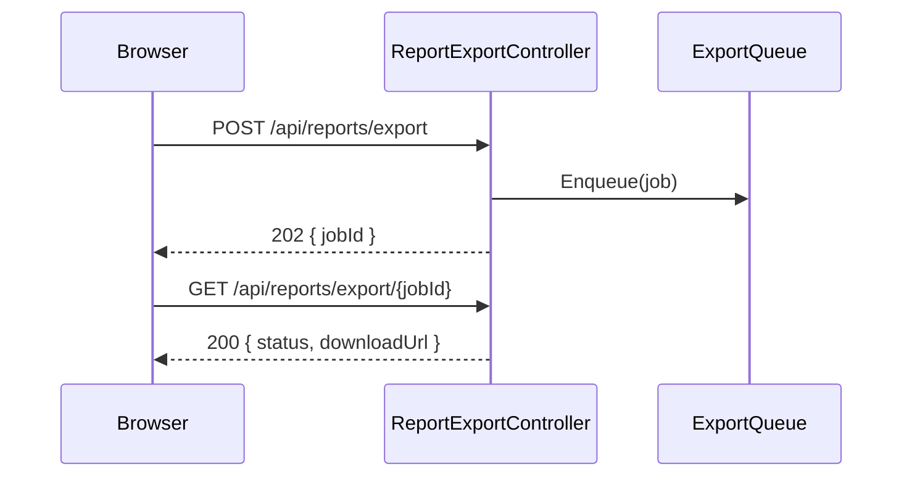

# Report export plumbing

This doc follows a user from clicking **Export** on a report to downloading the file. The formatting is intentionally uneven (tabs, ASCII arrows, lettered steps, a Mermaid diagram) to exercise the viewer.

## The pieces at a glance

| Piece | Where | What it does | Owner |
|---|---|---|---|
| Export page | `ClientApp/src/reports/export/ExportPage.vue` | The dialog. Picks a format, calls `requestExport`, polls with `pollStatus`, shows the download link. | Reporting team |
| Export API client | `ClientApp/src/reports/export/api.ts` | `requestExport()` and `pollStatus()`. | Reporting team |
| Export API | `Controllers/Api/ReportExportController.cs` | `POST /api/reports/export` (start a job) and `GET /api/reports/export/{jobId}` (status). See [the export ADR](https://example.invalid/adr/0012-report-export) for the queue decision. | Platform team |
| Export use case | `GraspANALYTICS.Core/Application/Reports/UseCases/ReportExportUseCase.cs` | Validates the request, creates the job, enqueues it. | Platform team |
| Export worker | `Reports/Export Service/ReportExportService.cs` | Hosted service that dequeues jobs and renders them. | Platform team |
| Renderers | `Reports/Rendering/PdfReportRenderer.cs` + `Reports/Rendering/XlsxReportRenderer.cs` | One renderer per format behind `IReportRenderer`. | Platform team |
| Blob storage | `Core/Infrastructure/Storage/AzureBlobStore.cs` | Stores the rendered file for 24 hours. | Platform team |

## 1. Starting an export

```text
ExportPage.download()
	├─ requestExport(reportId, format)
	│	└─ POST /api/reports/export
	└─ pollStatus(jobId)
		└─ GET /api/reports/export/{jobId}
```

`ExportPage.mounted()`:

- Loads what the dialog needs, then:
  a. calls `loadFormats()` for the formats the user may pick
  b. calls `loadRecentJobs()` so finished exports from the last hour are listed
- Falls back to PDF only when the formats call fails.

| Call | Server | Returns |
|---|---|---|
| `POST /api/reports/export` | `ReportExportController.StartAsync` → `IReportExportUseCase.ExecuteAsync` | `jobId`, `status: "queued" | "running" | "done"` |
| `GET /api/reports/export/{jobId}` | `ReportExportController.StatusAsync` → `IExportJobStore.GetAsync(jobId)` | `status`, `downloadUrl` when done |

## 2. On the server

```text
ReportExportController.StartAsync            [Authorize], [ApiController] model validation
  └─ request.ToCommand(userId)               ReportExportContractMapper -> ReportExportCommand(ReportId, Format, UserId)
  └─ IReportExportUseCase.ExecuteAsync
  └─ result.ToResponse()                     ReportExportOutcome -> ReportExportResponse { jobId, status }
  └─ 202, or the error status for the code
```

## 3. Inside `ReportExportUseCase`

```text
ExecuteAsync(command)
  ├─ IReportRepository.GetByIdAsync(command.ReportId)
  │     none -> RejectAsync -> ReportNotFound
  ├─ IReportAccessPolicy.CanExport(user, report) fails -> Forbidden
  ├─ IExportJobStore.CreateAsync(report, format)
  └─ IExportQueue.Enqueue(job) -> Queued
```

Any unexpected exception becomes `ExportFailed`, logged as EventId 23002.

## 4. The worker

```text
ReportExportService.RunAsync(job)
  └─ IExportJobStore.MarkRunningAsync(job)
  └─ IReportRepository.GetByIdAsync(job.ReportId)
  └─ IReportRenderer.RenderAsync(report, job.Format)        PdfReportRenderer
  └─ IBlobStore.SaveAsync(job.Id, bytes)                    AzureBlobStore
  └─ IExportJobStore.MarkDoneAsync(job, downloadUrl)
```

- `ReportExportService` runs as a hosted service with one worker per CPU.
- Renderers are picked by format:
  - `pdf` → `PdfReportRenderer`
    - uses the shared report template
      - headers and footers come from `GeneralSettings`
  - `xlsx` → `XlsxReportRenderer`

#### Retention

Files are deleted after 24 hours by `ExportCleanupJob`.

## Troubleshooting



- A job stuck in `queued` means no worker is running; check the `ReportExportService` log.
- A `Forbidden` on a report the user can open means `IReportAccessPolicy` denies export while allowing view.
